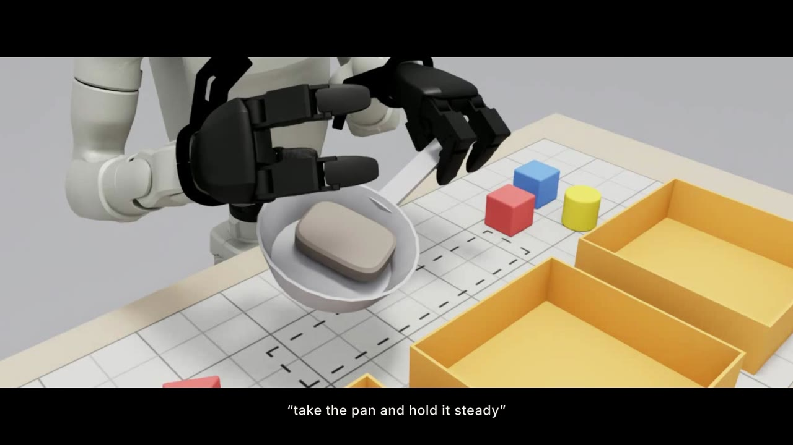
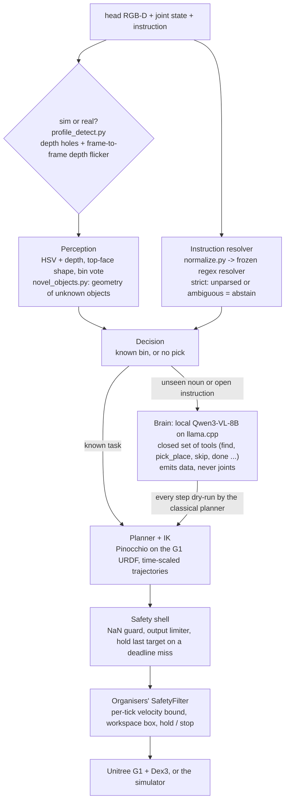
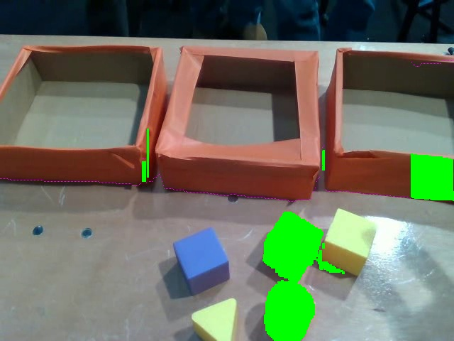
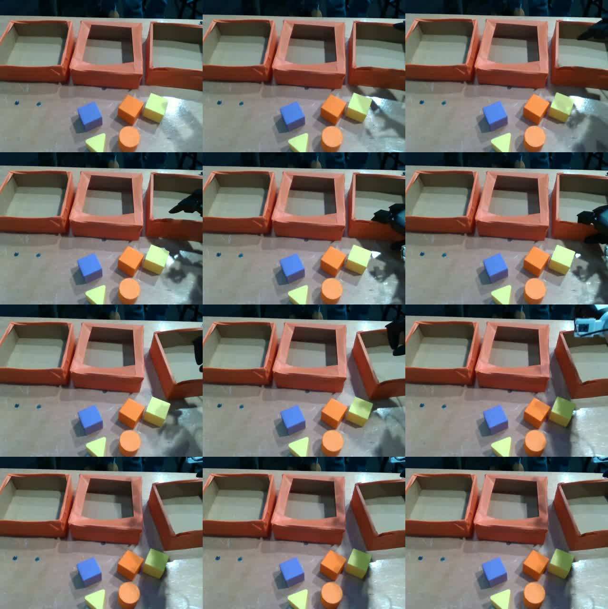

# Aaltonomous Humanoid — Junction 2026

[](https://github.com/cufelix/hackjunction/releases/tag/v1.0-submission)
[](https://github.com/cufelix/hackjunction/pkgs/container/hackjunction)
[](https://github.com/cufelix/hackjunction/actions/workflows/ci.yml)
[](LICENSE)

Starter code for the **Aaltonomous Humanoid** challenge: make Väiski, a Unitree G1 with two Dex3 hands, sort
coloured objects into bins fully autonomously. Develop in sim, hand in a Docker policy server, the best teams run on
the real robot in the finals.

## Demo

[](https://github.com/cufelix/hackjunction/releases/download/v1.0-submission/larp_interns_demo.mp4)

55 s of simulation footage from unedited runs of our policy: grasps, places, and an unseen frying pan lifted by its
handle. [Download the video](https://github.com/cufelix/hackjunction/releases/download/v1.0-submission/larp_interns_demo.mp4).
The submitted code is tagged [`v1.0-submission`](https://github.com/cufelix/hackjunction/releases/tag/v1.0-submission).

## Our solution: a classical sorter with a gated brain

Scoring drives the design. A wrong drop costs -1 and no drop costs 0, so every stage would rather hold or abstain than
guess. On the known tasks no learned model is on the control path. A local vision-language model (VLM) only steps in
for what the classical stack cannot name: an unseen object or an open instruction. Details and file references are in
[docs/ARCHITECTURE.md](docs/ARCHITECTURE.md). The finals overlay is
`aaltonomous/baselines/classical/overlays/finals_r25_gen.yaml`.

### Architecture



- **The brain is gated.** With `brain.known_task_hard_off`, a known task (the resolver covers the sentence and no
  noun is unknown) makes no brain call at all. The action stream is then identical to running with the brain disabled
  (`TestKnownTaskHardOff` in `test_universal.py`). The brain may never change a bin the classical stack already knows.
- **It never blocks the 30 Hz loop.** Brain requests run on a worker thread, and the server's health is re-probed at
  every reset. If the server is down on an open instruction, the arms go home and the policy re-probes every 3 s for
  up to 60 s, then carries on or stops (`test_brain_ready.py`; `act()` p95 stays under 30 ms during the wait).
- **Sim or real is detected from the first frames, not from a flag.** A simulator render has no invalid depth pixels
  and is bit-identical between frames of a still scene. The D435i always has a shadow band of holes and re-measures
  every pixel. The policy calls a run real if either cue fires, and sim only if both are quiet. Real-only fixes are
  then switched on, and `profile_auto.sim_overrides` restores the sim values.

### Generality

- **Unseen objects are understood from their shape, not their name.** `novel_objects.py` takes an above-table depth
  blob that matches no known colour and looks for an elongated part sticking out of the body: a handle. The grasp goes
  across the handle's width. A part narrower than 15 mm is rejected, so a screwdriver is held by its handle, not its
  shaft. For a frying pan (a 20 cm disc with a 12 x 3 cm handle), `test_handle_grasp.py` checks 9 cases:
  - the handle is grasped across its width, and the planner closes on it;
  - a plain disc is not taken for a handle;
  - a pan cut off by the image edge keeps its visible handle;
  - a wok is grounded by the VLM and grasped by its handle.

  No word in the instruction picks the grasp point.
- **Unknown nouns.** "Put the pan in the left bin" names nothing the colour resolver knows. The VLM grounds the noun
  in the head image (`brain/find.py`). The result becomes an ordinary detection, and the classical planner plans the
  grasp.
- **Unseen wordings.** We fed the resolver 60 phrasings it was not written for: polite, sloppy, negated, contradictory
  and nonsense. It resolved 37 as intended and abstained on 19. Three of the other four map orange and purple to red
  and blue, which is by design: orange and purple are the real objects that stand in for the sim colours. The fourth
  drops the unknown noun in "the stapler and the red ones" and keeps "red goes left". Of 10 negations, 8 abstain
  ("don't put red on the left") and 2 "except" forms resolve: "everything except purple goes right" leaves the purple
  objects where they are and moves the rest. With the
  brain on, an abstained open sentence goes to the brain planner, whose plan is checked step by step.
- **Abstain rather than guess.** Strict mapping, the red/yellow hue guard, the lid guard and the novel-object
  checks all end in "no pick" when unsure.

### What the real robot taught us

All three fixes are real-only. The sim/real detector switches them on, and the sim keeps its tested values.

- **Table height.** In the organisers' debug log of our real run, the robot saw no objects at all. The committed table
  height was 3.2 cm off the plane the head camera measured, so the height gate rejected every object. The fix:
  - The policy now measures the table on every run: a dominant-plane fit on head depth within ±0.30 m, gated by tilt,
    inlier count and RMS (`calib.plane.robust_height`).
  - The older fit is kept only when it agrees with that measurement within 1 cm (`calib.plane.robust_agree_m`).
  - The nominal height is used only when nothing could be measured.
  - Detections handed to the planner are mapped into the calibration camera's frame (`perception.plan_frame`).
- **Arm sag.** The runner's arm PD has no gravity term (kp 80 at the shoulders and elbow, 40 at the wrists), so the
  arm sags by roughly gravity torque / kp.
  - We send the URDF gravity torque in the organisers' `arm_tau_ff` field.
  - On top of that, `sag_comp.py` adds a bounded position offset, q_cmd = q_plan + kappa * tau_g / kp.
  - kappa is estimated online from still ticks. It comes out as 0 when the runner already compensates, so the output
    is then bit-identical to running without the fix.
  - The offset stays below the runner's 0.12 rad clip, its rate is capped at 0.5 rad/s, and it is applied before the
    output limiter.
- **Reach clamp.** The IK reaches a drop point at x = 0.52 m only from a release height of 0.25 m or more. Drop points
  are clamped to x ≤ 0.52 m with release z ≥ 0.25 m, for voted bins and for fallback bins. An unvoted bin is centred
  so that its first drop slot sits just inside the near rim.

### Honest limits

- **Drills are not graspable.** The handle finder takes the chuck for a handle, because it is about as long as a pan
  handle. The real grip sticks out at right angles to the body. Telling the two apart needs a cue we do not have yet. Hammers, pliers,
  wrenches, mug handles, knives and spatulas are recorded as known failures in `test_tool_grasp.py`. Of its 23 cases,
  8 pass: the screwdriver at both angles, fruit, and hammer and pliers detection.
- **Lids abstain.** For `insert_shapes`, the lid holes are 3 to 10 cm beyond the arm's IK reach, and a release over
  the lid bin scores -1. `policy.insert_guard` therefore picks nothing: 0 points by design.
- **The sim/real thresholds were set without real depth data.** They come from sim renders and the sensor's known
  behaviour, because we had no recorded real depth to tune them on.
- **The brain has not been tested on the robot.** End-to-end runs with the real llama.cpp server take place on a GPU
  simulator box. The unit tests cover only a server that is down or late.

## Real-robot postmortem

In the finals the policy scored 0 points in both real runs (`sort_fixed`, seed 0, 15 Nov 2026). In simulation the same
code scored 478 of 527 objects over 128 episodes (64 seeds x 2 tasks), with 2 objects placed in the wrong bin. This
section records what happened on the robot, the cause, and what we changed afterwards. The brain never ran on the
real robot.

### What happened

The bins at the venue were wrapped in red-orange paper. In the simulator they are plain orange-yellow cardboard. In both
runs the colour gate kept 8 of 9 candidates, the policy picked "red", and the right arm went to a grasp point on the
right bin. The hand closed on the lower edge of the bin's front wall and dragged the bin out of position. The held
check passed, the release check failed twice, and the policy stopped at about 39 s of a 120 s run. No object was moved.





### Cause

1. **Gate row cutoff.** The image gate (`gate_below_bins`) only counted bin runs starting above row 216
   (`first_run_top_frac` 0.45 of 480). The right bin's front face starts at rows 215 to 222, so the gate put its
   bottom edge near row 89 instead of about 277 and let the wall through.
2. **Defences skipped while the gate is on.** With the gate active, the 3D footprint cut, the `in_bin` reject and the
   colour gate's workspace and bin rules were bypassed. The gate was meant as an extra layer and acted as a switch
   for the others.
3. **Blob splitting.** `split_blobs` cut the wall strip into cube-sized pieces before the `too_big` check ran. Colour
   could not separate them: robust red covers hue 0 to 16, the paper sits at 4 to 8 and the orange objects at 11 to 12.
4. **Hard-coded mapping.** `policy_server.py` always injected the venue colour-to-bin mapping for `sort_fixed`, so the
   instruction-first path was never reached. The instruction said red goes left, the mapping said right.
5. **`bin.vote` disagreed** in both runs (confidence 0.3), so live bin positions were not trusted. The real bins were
   8 to 15 cm from the nominal footprint. The logs do not show why the vote disagreed.
6. **Held detector and early stop.** Finger sum was 0.266 at close and 0.046 at lift against a 0.045 threshold, so a
   bin wall counted as held. After two failed release checks the policy stopped picking with 80 s left.

The hackathon hotfix (`bin_size_guard`) did not help: the surviving strip was below its size thresholds.

### Offline replay

`tools/venue_replay.py` runs perception on 11 labelled frames from the two real runs (RGB only, no depth, no GPU) and
counts accepted colour candidates that lie on a bin.

| Config | Candidates on a bin (11 frames) | Objects found |
|---|---|---|
| As run on the robot | 20 | 55/55 |
| As run + hotfix `bin_size_guard` | 20 | 55/55 |
| After the fix | 2 | 55/55 |

The two remaining candidates are the robot's own fingers, which the arm mask removes on the robot. On the frame the
robot used to choose its target, the old code ranks the right bin's wall first as "red"; the fix ranks the orange
cube first.

### Simulation check: inconclusive

We built a venue-twin scene (`aaltonomous/sim/VENUE_TWIN.md`: paper-coloured bin walls, brown bin interiors, venue
table and object colours sampled from the run video) and ran an A/B in Isaac Sim on `sort_fixed`, seeds 1000 to 1003:
the submitted code and the fix, each on the venue twin and on the nominal scene.

| Arm | Scene | Objects correct / total | Clips | Rate |
|---|---|---|---|---|
| submitted | nominal | 0 / 15 | 0 | ~30 Hz |
| submitted | venue twin | 0 / 15 | 0 | ~30 Hz |
| fix | nominal | 0 / 15 | 0 | ~30 Hz |
| fix | venue twin | 0 / 15 | 0 | ~30 Hz |

All four arms scored zero. The images were built with the real profile forced (`PROFILE_MODE=real`), and that profile
does not sort in simulation at all, so this run neither reproduces the failure nor validates the fix. No
`[grasp_diag]` lift values were captured. The only validation of the fix is the offline replay above.

### The fix and what it does not cover

The fix turns on `bin_image_guard` (rejects dark-warm components of bin size in the image), raises
`first_run_top_frac` to 0.55, keeps the `in_bin` defence active while the gate is on, and makes the `sort_fixed`
mapping instruction-first. `bin.vote` now logs its voters, and `bin.vote.tape_body_reject` ignores paper-wrapped bin
bodies (7.9k to 19k px in the replay frames) when looking for tape. Unit tests cover each piece.

Not covered:
- Not validated on real depth or on the robot.
- `grasp.wrong_object_recovery` (a stricter post-lift finger check and a bounded re-look after a failed release) is
  implemented but **off**: it needs a lift finger sum of at least 0.09, and only the venue bin wall (0.046 and 0.088)
  has ever been measured, never a genuine grasp.
- The reason `bin.vote` disagreed is unknown, and the organisers' colour-to-bin mapping is unconfirmed.

### Lessons

- Colour thresholds tuned on sim materials did not transfer: bin paper, orange objects and the red range overlapped.
- A guard that disables the footprint, `in_bin` and `too_big` checks turns three independent layers into one.
- Eleven frames and an RGB-only replay reproduced the failure offline. We had no venue-coloured data in the loop
  before the finals.
- The abstain rules in the resolver never fired because perception handed over a confident wrong candidate, and the
  held detector then confirmed it.
- Two failed release checks ended a 120 s run at 39 s. A bounded retry would have given a second attempt.

## Build the submitted image

To run it without building, pull the submitted image. It is a byte-identical, digest-pinned copy published by
`.github/workflows/publish-image.yml`:

```bash
docker pull ghcr.io/cufelix/hackjunction:final
```

The final image (`ghcr.io/dymyt-ry/pp9gi2f:final`) is built from this repo in two steps on an x86_64 host with
Docker and BuildKit. The brain stage compiles llama.cpp with CUDA, so it needs a few minutes and about 30 GB of disk.

```bash
# 1. Stage what is not in git: the G1 URDF, llama.cpp b12110 source, Qwen3-VL-8B-Instruct Q8_0 + mmproj
#    (about 9.5 GB, all sha256-checked). This is the only step that needs internet.
bash tools/brain/stage_brain.sh

# 2. Policy base, then the brain layer on top (llama-server and the model inside the image, no downloads at start)
docker build -f tools/submission.Dockerfile --build-arg OVERLAY=finals_r25_gen --build-arg PROFILE_MODE=auto \
    -t hackjunction/policy:final-base .
docker build -f tools/brain/Dockerfile.policy_brain --build-arg POLICY_IMAGE=hackjunction/policy:final-base \
    --build-arg BRAIN_ENABLED=1 --build-arg BRAIN_OVERLAY=finals_r25_gen --build-arg PROFILE_MODE=auto \
    -t hackjunction/policy:final .

# 3. Check it: server up within 120 s, brain answers, replay above 27 Hz
bash tools/brain/test_brain_image.sh hackjunction/policy:final 8371
python -m aaltonomous.deploy.replay --synthetic 100 --container hackjunction/policy:final
```

- `PROFILE_MODE=auto` lets the policy tell sim from the real robot at start-up. `sim` or `real` forces one profile.
- `BRAIN_ENABLED=0` builds the same image with the brain off. Step 2's first command alone gives the CPU-only image.
- Both Dockerfiles run the release checks (`tools/flags.py`, `tools/check_release_flags.py`) during the build, so a
  build with a wrong overlay or flag set fails.

## Challenge starter kit

| Start here | |
|---|---|
| [Challenge brief](aaltonomous/docs/participants/README.md) | Task, rungs, timeline, what to read next |
| [Quickstart](QUICKSTART.md) | Fresh cloud GPU instance → baseline running in sim (~15 min) |
| [Rules and scoring](aaltonomous/docs/participants/RULES_AND_SCORING.md) | Success rule, points, finalist selection |
| [Interface](aaltonomous/docs/participants/INTERFACE.md) | Observations, actions, joint order, limits, cameras |
| [Submission](aaltonomous/docs/participants/SUBMISSION.md) | Docker policy-server contract (websocket + msgpack, port 8000) |
| [Starter paths](aaltonomous/docs/participants/STARTER_PATHS.md) | Classical, VLM, IL/VLA, RL, real2sim |
| [FAQ](aaltonomous/docs/participants/FAQ.md) | |

## Layout

| Path | What |
|---|---|
| `aaltonomous/interface/` | `AaltoEnv`, joint spec, the safety filter every action goes through |
| `aaltonomous/deploy/`, `aaltonomous/docker/` | Policy-server template and submission Dockerfiles |
| `aaltonomous/sim/` | Isaac Lab task `Aalto-Sort-G129-Dex3-Joint`, evaluator, oracle, training DR config |
| `aaltonomous/scene/` | Scene geometry (`scene.yaml`), success checker, printable assets |
| `aaltonomous/baselines/classical/` | Classical perception + IK baseline |
| `aaltonomous/data/` | Real-demo recorder and LeRobot / GR00T converters |
| `aaltonomous/cloud/` | Instance setup, `aalto` CLI, sim image Dockerfile |

Unit tests (no GPU needed): `python -m unittest aaltonomous/interface/test_safety.py aaltonomous/interface/test_env.py
aaltonomous/scene/test_scene.py`.

Upstream dependencies (`unitree_sim_isaaclab`, `xr_teleoperate` for the G1 URDF, Isaac Lab) are cloned into
`third_party/` by `aaltonomous/cloud/setup_instance.sh`; the sim Docker image already contains them.

Organisers: DigiTwin, Aalto University. This repo is synced from our internal repo; please open issues or ask in the
challenge channel rather than sending PRs during the event.
